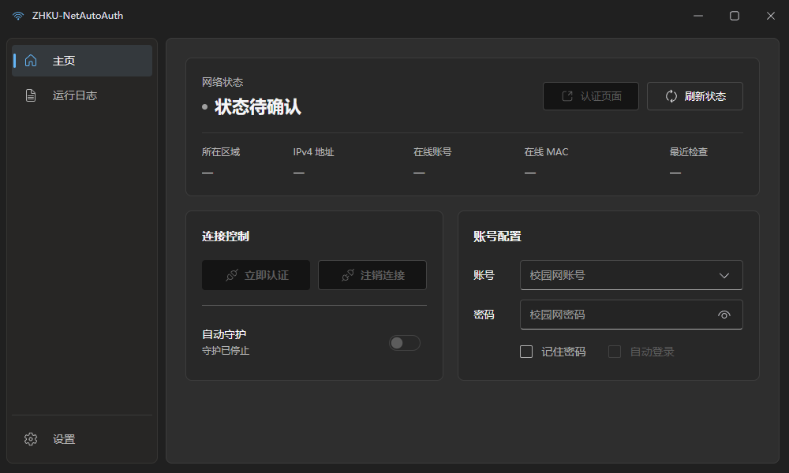

# ZHKU-NetAutoAuth

连接校园网后，还要反复打开浏览器、输入账号密码？**ZHKU-NetAutoAuth** 是面向仲恺农业工程学院**白云校区**的 Windows 校园网自动认证客户端。填写账号密码后即可登录，开启自动守护后，认证掉线会自动重新连接。

## 适合谁使用？

- 使用 **Windows 10 / 11，64 位**电脑的白云校区同学。
- **办公区**已支持认证、注销和断线自动重认证。
- **宿舍区目前仅支持区域识别，暂不支持自动认证。**

使用前，请先通过 Wi-Fi 或网线接入校园网。

## 下载

前往 [GitHub Releases](https://github.com/Jasonzzhu0514/ZHKU-NetAutoAuth/releases)，下载 Windows 桌面版的 exe 附件。无需安装 Python 或 Rust。

| 版本 | 下载文件 | 怎么选？ |
| --- | --- | --- |
| 安装版（推荐） | `ZHKU-NetAutoAuth-Setup.exe` | 按提示安装，提供开始菜单和卸载入口 |
| 便携版 | `ZHKU-NetAutoAuth.exe` | 无需安装，下载后双击运行 |

## 第一次使用

1. 接入校园网，启动客户端。
2. 根据首次启动说明，选择关闭窗口时「驻留系统托盘」或「退出程序」。以后也可以在左下角「设置」中修改。
3. 在「账号配置」中填写校园网账号和密码，点击「立即认证」。
4. 按需勾选「记住密码」和「自动登录」，方便下次使用。
5. 确认网络状态显示「已通过认证」，开启「自动守护」，让客户端在认证掉线时自动重新登录。

「自动登录」会同时开启记住密码，下次启动客户端时自动认证并开启守护。

## 日常怎么用？

| 操作 | 用途 |
| --- | --- |
| 自动守护 | 定期检查连接，认证掉线时自动重新登录；需要先填写账号密码 |
| 刷新状态 | 手动检查认证状态、所在区域和在线信息 |
| 认证页面 | 在默认浏览器中打开所在区域的校园网认证页面 |
| 注销连接 | 注销校园网、停止守护，并关闭下次启动的自动登录 |
| 运行日志 | 查看本机日期时间对应的原始日志，可筛选异常、复制和清空 |
| 设置 | 调整关闭窗口行为、守护检查间隔，管理更新和查看关于信息 |

守护默认每 **30 秒**检查一次，可以在设置中调整为 **30～3600 秒**。网络异常时会延长重试间隔。

「记住密码」会将账号密码加密保存在本机；取消勾选后清除保存的密码，本次输入仍可用于认证。需要删除保存的账号时，先停止守护并等待请求完成，再点击账号框右侧的下拉箭头，在保存账号旁点击 ×。删除账号不会注销网络。

### 放到后台

在设置中选择「驻留系统托盘」后，关闭窗口仍会继续运行已开启的守护。双击托盘图标，或右键选择「打开窗口」，即可返回界面。

托盘菜单中的「退出程序」会停止守护并退出，不会主动注销校园网。**隐藏窗口不会自动开启守护**，请先打开守护开关。

### 更新软件

在「设置 → 软件更新」中检查新版本，也可以开启联网后自动检查更新。发现更新后，按提示下载，再确认「安装并重启」；软件不会自行下载或安装。

更新会保留现有配置。已记住密码时，更新前正在运行的守护会在重启后恢复；未记住的密码需要重新输入。如果软件内更新失败，可以直接从 Releases 下载新版。

## 常见问题

**无法识别区域或认证失败？**

先确认已接入白云校区校园网，检查账号密码，再点击「刷新状态」。如果使用代理或 VPN，请检查是否影响校园网访问；仍有问题时，可点击「认证页面」尝试浏览器登录，并查看「运行日志」中的异常信息。

**关闭窗口后，为什么没有自动重连？**

需要同时开启「自动守护」，并在设置中选择「驻留系统托盘」。如果选择退出程序，或托盘不可用，关闭窗口就会停止守护。

**自动登录能让软件开机启动吗？**

不能。自动登录在你启动客户端后生效，目前没有开机启动设置。

**卸载后，账号和设置会被删除吗？**

默认保留，重装后可以继续使用。需要清除时，在卸载向导中勾选「同时删除账号与设置」。安装版和便携版共用配置，清除后便携版也需要重新填写。

## 反馈问题

可在「设置 → 关于 → 反馈问题」中打开反馈页面，或直接前往 [GitHub Issues](https://github.com/Jasonzzhu0514/ZHKU-NetAutoAuth/issues)。请说明软件版本、所在区域、具体操作和异常现象。

分享截图或日志前，请遮挡账号、IP、MAC 等个人信息，**不要提供密码**。日志仅保存在本次运行的内存中，密码等敏感凭据会脱敏。

## 开发与许可证

想从源码运行或参与开发，请阅读 [开发文档](docs/DEVELOPMENT.md)。

本项目采用 [MIT 许可证](LICENSE)，第三方依赖遵循各自的许可证。软件内「关于」也可离线查看许可全文。
